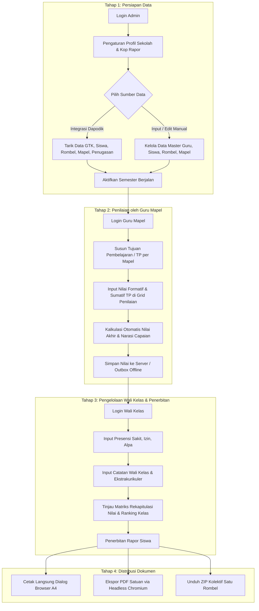

# Rapor SMK: Penilaian Tengah Semester (Kurikulum Merdeka)

Aplikasi pengelolaan dan penerbitan rapor Penilaian Tengah Semester (PTS / STS) untuk Sekolah Menengah Kejuruan (SMK) berbasis Kurikulum Merdeka. Sistem ini mendukung integrasi langsung dengan Web Service Dapodik lokal serta menyediakan manajemen data mandiri di tingkat sekolah.

---

## Alur Kerja Sistem (Workflow)



---

## Modul dan Fitur

### 1. Sinkronisasi Dapodik dan Manajemen Data Master
- **Integrasi Web Service Dapodik**: Konfigurasi host, port, token, dan NPSN langsung melalui Web UI (`/settings/dapodik`) dengan pengujian koneksi dan diagnostik status.
- **Tarik Data 5 Entitas**: Mengambil data GTK (Guru), Rombongan Belajar, Peserta Didik, Mata Pelajaran, dan Pembelajaran (Penugasan Mengajar).
- **Proteksi Data Manual (Manual Override)**: Penyesuaian data guru, siswa, rombel, mapel, atau penugasan yang ditambahkan atau disunting secara manual tidak akan tertimpa saat sinkronisasi Dapodik dijalankan ulang.
- **Kelompok Mata Pelajaran**: Pengelompokan mata pelajaran standar Kurikulum Merdeka (Kelompok A Muatan Umum, Kelompok B Kejuruan, Kelompok C Pilihan, dan Muatan Lokal) dengan pengaturan nomor urut cetak.

### 2. Pengaturan Profil Identitas Sekolah
- **Kop Surat Rapor**: Konfigurasi tiga baris teks kop surat dinamis (Pemerintah Provinsi, Dinas Pendidikan, dan Nama Satuan Pendidikan).
- **Logo Sekolah**: Dukungan unggah dua logo (logo kiri pemerintah daerah dan logo kanan sekolah) dalam format Base64.
- **Data Penandatanganan**: Pengaturan nama dan NIP Kepala Sekolah, tempat titimangsa cetak, serta tanggal pembagian rapor PTS maupun PAS.

### 3. Pengelolaan Tujuan Pembelajaran (TP)
- **Lingkup per Guru Pengampu**: Setiap guru mapel dapat mengelola kode TP (contoh: `TP-1.1`, `TP-1.2`) dan deskripsi kompetensi pembelajarannya sendiri.
- **Dukungan TP Global**: Admin dapat menyediakan draf TP bawaan kurikulum yang dapat langsung dimanfaatkan oleh guru.

### 4. Input Nilai dan Generasi Deskripsi Otomatis
- **Grid Penilaian Interaktif**: Input nilai per TP dengan kalkulasi rerata nilai akhir secara langsung di sisi peramban.
- **Penyusunan Narasi Capaian Otomatis**: Sistem merangkum capaian tertinggi (kompetensi yang sudah dikuasai dengan sangat baik) dan capaian terendah (kompetensi yang memerlukan bimbingan lanjutan) menjadi narasi resmi Kurikulum Merdeka. Guru tetap memiliki kendali untuk menyunting deskripsi secara manual.
- **Pencegahan Duplikasi Request**: Middleware idempotensi mencegah pengiriman ganda saat tombol simpan ditekan berulang kali dalam jeda singkat.

### 5. Pengelolaan Wali Kelas
- **Matriks Rekapitulasi**: Tampilan seluruh nilai mata pelajaran per siswa dalam satu kelas, dilengkapi statistik nilai rata-rata siswa dan rerata rombel.
- **Presensi**: Pencatatan data ketidakhadiran (Sakit, Izin, Tanpa Keterangan) dengan fitur penambahan cepat dan penyimpanan batch.
- **Ekstrakurikuler dan Catatan Perkembangan**: Pencatatan predikat kegiatan ekskul serta catatan motivasi wali kelas dengan tombol bantuan template kalimat.

### 6. Cetak dan Distribusi Dokumen Rapor
- **Format Cetak Standar A4**: Tampilan pratinjau rapor berbasis HTML dan CSS `@media print` yang rapi saat dicetak langsung melalui dialog browser.
- **Ekspor PDF Berkualitas Tinggi**: Pembuatan dokumen PDF di backend memanfaatkan Headless Chromium untuk tata letak dokumen yang konsisten.
- **Unduh ZIP Kolektif**: Kemampuan mengunduh seluruh dokumen PDF rapor siswa dalam satu rombel sekaligus dalam format file `.zip` dengan penamaan terstruktur (`01_NISN_Nama.pdf`).

### 7. Mode Offline dan Ketahanan Sesi
- **Penyimpanan Lokal (IndexedDB)**: Guru dapat terus menginput nilai dan presensi saat jaringan internet terputus. Data draf tersimpan di outbox lokal dan disinkronkan otomatis saat koneksi pulih.
- **In-Place Re-authentication**: Apabila sesi JWT habis di tengah penginputan, dialog login ulang akan muncul tanpa me-refresh halaman, menjaga draf nilai guru tetap aman.

---

## Teknologi yang Digunakan

| Komponen | Spesifikasi / Pustaka |
|---|---|
| **Backend** | Go (Golang) 1.22+ dengan Gin Web Framework |
| **Database & ORM** | PostgreSQL 16 dengan GORM |
| **Pustaka Migrasi** | golang-migrate/migrate (11 berkas migrasi SQL sekuensial) |
| **In-Memory Cache** | Redis 7 (Caching statistik dashboard dan progres penilaian) |
| **Mesin Render PDF** | Chromium / Google Chrome Headless (`--headless --print-to-pdf`) |
| **Frontend** | React 19, TypeScript, Vite |
| **Antarmuka & Gaya** | Tailwind CSS v4, Lucide React Icons |
| **Penyimpanan Offline** | IndexedDB via idb wrapper |
| **Web Server & Reverse Proxy** | Nginx Alpine |
| **Kontainerisasi** | Docker & Docker Compose |

---

## Struktur Direktori Proyek

```text
rapor-smk/
├── backend/
│   ├── cmd/
│   │   ├── server/main.go          # Entry point server Gin & seeder default
│   │   └── migrate/main.go         # Runner migrasi SQL database
│   ├── config/                     # Konfigurasi database PostgreSQL, Redis, dan env
│   ├── controllers/                # Handler API (Auth, Dapodik, Master, Nilai, Rapor, Sekolah)
│   ├── middleware/                 # JWT Auth, CORS, Rate Limiter, Idempotensi
│   ├── migrations/                 # Berkas SQL migrasi database (000001 s/d 000011)
│   ├── models/                     # Definisi struct entitas database GORM
│   ├── routes/                     # Konfigurasi routing endpoint API
│   ├── services/                   # Layanan sinkronisasi Dapodik, kalkulasi nilai, PDF, dan ZIP
│   └── Dockerfile                  # Multi-stage build Go binary dan instalasi Chromium
├── frontend/
│   ├── src/
│   │   ├── components/             # Komponen antarmuka (Navbar, Sidebar, Modal Reauth)
│   │   ├── context/                # Context otentikasi dan notifikasi toast
│   │   ├── hooks/                  # Custom hook (misal: useOfflineSync)
│   │   ├── pages/                  # Halaman aplikasi (Dashboard, Input Nilai, Rekap, Profil Sekolah)
│   │   ├── services/               # API client dan modul database offline (IndexedDB)
│   │   └── types/                  # Definisi antarmuka TypeScript
│   ├── nginx.conf                  # Konfigurasi Nginx produksi dan reverse proxy /api/
│   └── Dockerfile                  # Multi-stage build frontend dan image Nginx
├── docker-compose.yml              # Konfigurasi deployment multi-container
├── ecosystem.config.cjs            # Konfigurasi proses manager PM2
├── .env.example                    # Template variabel lingkungan
└── README.md                       # Dokumentasi resmi proyek
```

---

## Panduan Instalasi dan Menjalankan

### Opsi 1: Menggunakan Docker Compose (Direkomendasikan untuk Server)

1. **Salin berkas konfigurasi lingkungan**:
   ```bash
   cp .env.example .env
   # Sesuaikan kredensial DB_PASSWORD, JWT_SECRET, dan konfigurasi lainnya
   ```

2. **Jalankan basis data dan Redis**:
   ```bash
   docker compose up -d postgres redis
   ```

3. **Jalankan migrasi skema database**:
   ```bash
   docker compose run --rm backend /app/migrate -dir=up
   ```

4. **Nyalakan seluruh layanan aplikasi**:
   ```bash
   docker compose up -d
   ```

5. **Akses aplikasi**:
   - Web Frontend: `http://localhost:3000` (atau port `80`)
   - Cek Kesehatan API: `http://localhost:8080/api/v1/health`

---

### Opsi 2: Menjalankan Manual di Lingkungan Lokal (Development)

#### Prasyarat
- Go versi 1.22 atau lebih baru
- Node.js versi 20 atau lebih baru dan npm
- PostgreSQL versi 16 aktif
- Redis versi 7 aktif
- Chromium atau Google Chrome terpasang di sistem

#### Langkah Menjalankan

1. **Persiapan Database dan Backend**:
   ```bash
   cd backend
   cp ../.env.example .env
   
   # Eksekusi migrasi database
   go run ./cmd/migrate/main.go -dir=up
   
   # Jalankan server API
   go run ./cmd/server/main.go
   ```
   Server backend berjalan di `http://localhost:8080`.

2. **Persiapan Frontend**:
   ```bash
   cd ../frontend
   npm install
   npm run dev
   ```
   Aplikasi frontend berjalan di `http://localhost:5173`.

---

## Kredensial Masuk Bawaan

| Peran Akun | Kredensial Login (NIP / Email) | Kata Sandi Awal | Hak Akses |
|---|---|---|---|
| **Administrator** | `admin` (atau `admin@smk.sch.id`) | `admin123` | Kelola sinkronisasi Dapodik, data master, profil sekolah, dan semester aktif |
| **Guru Mata Pelajaran** | NIP guru hasil sinkronisasi Dapodik | `guru1234` | Penyusunan TP dan pengisian nilai pada mata pelajaran yang diampu |
| **Wali Kelas** | NIP guru yang ditugaskan sebagai wali kelas | `guru1234` | Pengisian presensi, catatan wali, ekskul, rekap nilai kelas, dan cetak rapor |

*Catatan: Pengguna yang masuk menggunakan kata sandi bawaan akan diminta untuk memperbarui kata sandi saat pertama kali login.*

---

## Catatan Deployment & Tunneling (Cloudflared)

Aplikasi dirancang agar ramah terhadap arsitektur reverse proxy dan tunneling. Pada konfigurasi Nginx frontend ([`frontend/nginx.conf`](file:///home/nutrisari/Project/web/rapor-smk/frontend/nginx.conf)), seluruh request dengan rute `/api/` otomatis diteruskan ke service backend di port `8080`.

Saat melakukan tunneling menggunakan Cloudflare Tunnel (`cloudflared`):
1. Anda cukup mengarahkan `hostname` domain Anda ke port web server frontend (contoh: `http://localhost:80` atau `http://localhost:3000`).
2. Tidak perlu membuka port backend secara terpisah ke publik karena seluruh komunikasi API ditangani di dalam jaringan internal reverse proxy.

---

## Lisensi
Hak Cipta © 2026 Rapor SMK. Diterbitkan untuk keperluan administrasi kurikulum merdeka dan pelaporan penilaian hasil belajar sekolah menengah kejuruan.
