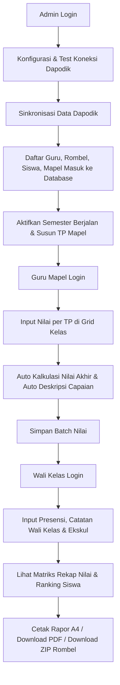

# Rapor SMK — Penilaian Tengah Semester (Kurikulum Merdeka)

Aplikasi manajemen dan penerbitan **Rapor Penilaian Tengah Semester (PTS / STS)** untuk Sekolah Menengah Kejuruan (SMK) berbasis **Kurikulum Merdeka**, terintegrasi langsung dengan **Web Service Dapodik**.

---

## 🌟 Fitur Utama

### 1. Integrasi & Sinkronisasi Dapodik Otomatis
- **Konfigurasi Tersimpan di Database**: Pengaturan IP/Host server Dapodik, port web service, NPSN, dan token otorisasi dapat diatur secara fleksibel melalui antarmuka Web UI (`/settings/dapodik`).
- **Diagnostik Koneksi Real-time**: Menampilkan status ping, latensi (ms), dan diagnostik detail jika koneksi gagal (DNS, timeout, refused, 401 token tidak valid).
- **Engine Sinkronisasi 5 Kategori**:
  1. **GTK (Guru & Tenaga Kependidikan)** $\rightarrow$ Akun guru otomatis dibuat dengan multi-kredensial login (NIP/NIK/Email).
  2. **Rombongan Belajar (Rombel)** $\rightarrow$ Penetapan tingkat kelas dan tautan Wali Kelas.
  3. **Peserta Didik (Siswa)** $\rightarrow$ Data NISN, NIS, tempat/tanggal lahir, jenis kelamin.
  4. **Mata Pelajaran** $\rightarrow$ Ekstraksi mapel kejuruan dan umum dari Dapodik.
  5. **Pembelajaran / Penugasan Guru** $\rightarrow$ Pemetaan guru pengampu per mapel di tiap rombel.
- **Deteksi Perubahan SHA-256**: Mencegah overwrite data yang tidak berubah, hemat resource, dan atomic lock untuk menghindari konkurensi sync ganda.

### 2. Penilaian Formatif & Sumatif per Tujuan Pembelajaran (TP)
- **Tujuan Pembelajaran (TP) Terstruktur**: Guru dan admin dapat mendefinisikan kode TP (e.g. `TP-1.1`, `TP-1.2`) dan deskripsi kompetensi per mata pelajaran.
- **Grid Input Nilai Reaktif**: Tampilan tabel reaktif dengan kolom TP dinamis.
- **Kalkulasi Otomatis Nilai Akhir**: Nilai rata-rata dari seluruh TP langsung terhitung secara live saat guru mengetikkan nilai.
- **Auto-Generate Deskripsi Capaian Kompetensi Kurikulum Merdeka**: Sistem otomatis menganalisis capaian TP tertinggi (penguasaan optimal) dan TP terendah (aspek yang memerlukan bimbingan lanjutan) menjadi kalimat narasi resmi siap cetak, dengan opsi sunting manual.

### 3. Pengelolaan Wali Kelas
- **Matriks Rekapitulasi Nilai Siswa**: Tabel matriks seluruh siswa $\times$ seluruh mata pelajaran per rombel, dilengkapi rata-rata nilai siswa, rata-rata kelas, dan pemeringkatan kelas otomatis (🥇 🥈 🥉).
- **Presensi & Ketidakhadiran**: Pencatatan Sakit (S), Izin (I), dan Tanpa Keterangan (A) dengan tombol akumulasi instan `+1` dan simpan batch.
- **Catatan Wali Kelas**: Catatan narasi motivasi dan evaluasi perkembangan tengah semester dilengkapi tombol template rekomendasi cepat.
- **Kegiatan Ekstrakurikuler**: Pencatatan nama ekskul, predikat (Sangat Baik / Baik / Cukup), dan keterangan kegiatan siswa.

### 4. Cetak Rapor & Ekspor Dokumen
- **Pratinjau Kertas A4 Digital**: Visualisasi format resmi rapor Kurikulum Merdeka SMK di peramban (Kop sekolah, Identitas Siswa, Tabel Nilai & Capaian, Ekskul, Presensi, Catatan Wali Kelas, dan Tanda Tangan 3 Pihak).
- **Cetak Langsung (`window.print`)**: Didesain dengan CSS `@media print` sehingga dialog print peramban langsung mengisolasi dokumen A4 tanpa navbar atau sidebar.
- **Ekspor Dokumen PDF**: Dihasilkan via **Headless Google Chrome** di backend untuk menghasilkan PDF berstandar cetak A4.
- **Download Batch ZIP**: Mengemas seluruh PDF rapor siswa dalam satu kelas ke dalam satu file `.zip` dengan penomoran urut (`01_NISN_Nama.pdf`).
- **Monitoring Progres Penilaian**: Visualisasi persentase kelengkapan input nilai per mapel per rombel yang dapat dipantau di Dashboard dan halaman Rapor.

---

## 🛠️ Tech Stack

| Komponen | Teknologi |
|---|---|
| **Backend Framework** | [Go (Golang) 1.26](https://golang.org) + [Gin Web Framework](https://gin-gonic.com) |
| **Database ORM** | [GORM](https://gorm.io) dengan database [PostgreSQL 16](https://www.postgresql.org) |
| **In-Memory Cache** | [Redis 7](https://redis.io) (Caching Dashboard stats & Grade progress) |
| **PDF Rendering** | Headless Google Chrome / Chromium CLI (`--print-to-pdf`) |
| **Frontend Framework** | [React 19](https://react.dev) + [TypeScript](https://www.typescriptlang.org) |
| **Build Tool & Bundler**| [Vite](https://vitejs.dev) dengan per-route Code Splitting (`React.lazy`) |
| **Styling & UI Tokens**| [Tailwind CSS v4](https://tailwindcss.com) + Material Design 3 (M3 Design System) |
| **Ikon** | [Lucide React](https://lucide.dev) |
| **Containerization** | Docker & Docker Compose multi-stage builds |

---

## 📁 Struktur Direktori

```text
rapor-smk/
├── backend/
│   ├── cmd/
│   │   ├── server/main.go          # Entry point server Gin
│   │   └── migrate/main.go         # Runner migrasi SQL
│   ├── config/                     # Koneksi Database, Redis, dan Environment
│   ├── controllers/                # Handler API (Auth, Dapodik, Grades, Rapor, dll)
│   ├── middleware/                 # JWT Auth, CORS, Role-based guards
│   ├── migrations/                 # File migrasi SQL (000001, 000002, 000003)
│   ├── models/                     # GORM Structs (User, Rombel, Student, Grade, dll)
│   ├── services/                   # Dapodik Sync, Grade Engine, Report & PDF Engine
│   └── Dockerfile                  # Multi-stage build Go backend + Chromium runner
├── frontend/
│   ├── src/
│   │   ├── components/             # Sidebar, Navbar, MobileNav, ErrorBoundary, Skeleton
│   │   ├── context/                # AuthContext, ToastContext
│   │   ├── pages/                  # Dashboard, Grades, Recap, Attendance, Reports, Settings
│   │   ├── services/               # Client API (api.ts, auth, master, grade, report)
│   │   └── types/                  # TypeScript interfaces
│   ├── nginx.conf                  # Nginx configuration (SPA routing & API proxy)
│   └── Dockerfile                  # Multi-stage build Node Vite + Nginx
├── docker-compose.yml              # Konfigurasi container produksi (Postgres, Redis, API, Web)
├── .env.example                    # Template variabel lingkungan
└── README.md                       # Dokumentasi resmi
```

---

## 🚀 Panduan Menjalankan Aplikasi

### Opsi A: Menjalankan dengan Docker Compose (Sangat Disarankan)

1. **Salin file environment**:
   ```bash
   cp .env.example .env
   ```

2. **Jalankan seluruh service**:
   ```bash
   docker compose up -d --build
   ```

3. **Buka peramban**:
   - Web Aplikasi Rapor: `http://localhost:3000` (atau `http://localhost:80`)
   - API Backend: `http://localhost:8080/api/v1/health`

---

### Opsi B: Menjalankan Secara Lokal (Development)

#### 1. Persyaratan Sistem
- Go 1.22 atau lebih baru
- Node.js 20+ dan npm
- PostgreSQL 16
- Redis 7
- Google Chrome atau Chromium (`/usr/bin/google-chrome` atau `chromium-browser`)

#### 2. Setup Database & Backend
```bash
cd backend

# 1. Jalankan migrasi database
go run ./cmd/migrate/main.go -dir=up

# 2. Jalankan backend server
go run ./cmd/server/main.go
# Server berjalan pada http://localhost:8080
```

#### 3. Setup Frontend
```bash
cd frontend

# 1. Install dependencies
npm install

# 2. Jalankan dev server Vite
npm run dev
# Frontend berjalan pada http://localhost:5173
```

---

## 🔐 Kredensial Login Bawaan

| Role | Kredensial Login (NIP / Email) | Kata Sandi Awal | Deskripsi |
|---|---|---|---|
| **Admin** | `admin` (atau `admin@smk.sch.id`) | `admin456` | Kelola koneksi Dapodik, semester, TP, dan monitor seluruh kelas |
| **Guru Pengampu** | NIP guru hasil sinkronisasi Dapodik | `guru1234` | Input nilai formatif & sumatif per TP pada mapel yang diampu |
| **Wali Kelas** | NIP guru yang ditugaskan sebagai wali kelas | `guru1234` | Kelola presensi, catatan siswa, ekstrakurikuler, matriks rekap, & cetak rapor |

*(Catatan: Pengguna dengan kata sandi awal akan diarahkan untuk memperbarui kata sandi pada login pertama).*

---

## 📄 Alur Penggunaan Aplikasi (Workflow)



---

## 📄 Lisensi
Hak Cipta © 2026 Rapor SMK. Dikembangkan untuk efisiensi administrasi kurikulum merdeka dan integrasi Dapodik sekolah kejuruan.
